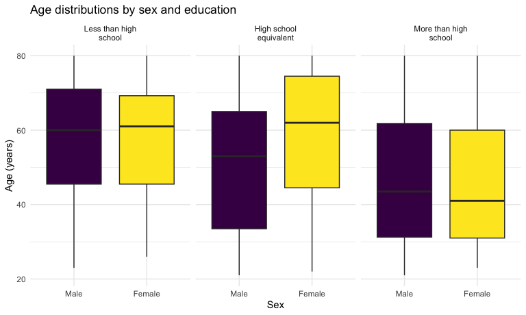
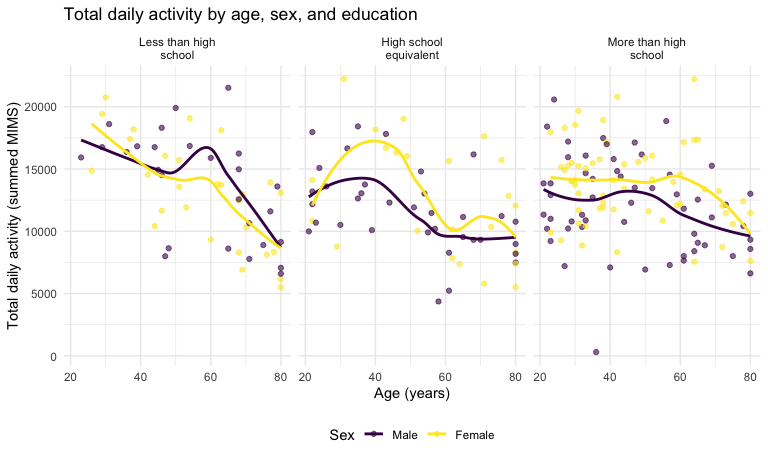

Homework 3
================
Stephanie Chuquipul Calderon
2026-10-18

## Problem 1

``` r
data("ny_noaa")

ny_noaa
```

    ## # A tibble: 2,595,176 × 7
    ##    id          date        prcp  snow  snwd tmax  tmin 
    ##    <chr>       <date>     <int> <int> <int> <chr> <chr>
    ##  1 US1NYAB0001 2007-11-01    NA    NA    NA <NA>  <NA> 
    ##  2 US1NYAB0001 2007-11-02    NA    NA    NA <NA>  <NA> 
    ##  3 US1NYAB0001 2007-11-03    NA    NA    NA <NA>  <NA> 
    ##  4 US1NYAB0001 2007-11-04    NA    NA    NA <NA>  <NA> 
    ##  5 US1NYAB0001 2007-11-05    NA    NA    NA <NA>  <NA> 
    ##  6 US1NYAB0001 2007-11-06    NA    NA    NA <NA>  <NA> 
    ##  7 US1NYAB0001 2007-11-07    NA    NA    NA <NA>  <NA> 
    ##  8 US1NYAB0001 2007-11-08    NA    NA    NA <NA>  <NA> 
    ##  9 US1NYAB0001 2007-11-09    NA    NA    NA <NA>  <NA> 
    ## 10 US1NYAB0001 2007-11-10    NA    NA    NA <NA>  <NA> 
    ## # ℹ 2,595,166 more rows

``` r
ny_noaa |>
  summarize(across(everything(), ~ mean(is.na(.x)))) |>
  pivot_longer(
    cols = everything(),
    names_to = "variable",
    values_to = "proportion_missing"
  ) |>
  knitr::kable(digits = 3)
```

| variable | proportion_missing |
|:---------|-------------------:|
| id       |              0.000 |
| date     |              0.000 |
| prcp     |              0.056 |
| snow     |              0.147 |
| snwd     |              0.228 |
| tmax     |              0.437 |
| tmin     |              0.437 |

``` r
ny_noaa |>
  summarize(
    n_stations = n_distinct(id),
    first_date = min(date),
    last_date = max(date)
  )
```

    ## # A tibble: 1 × 3
    ##   n_stations first_date last_date 
    ##        <int> <date>     <date>    
    ## 1        747 1981-01-01 2010-12-31

The ny_noaa dataset contains 2,595,176 observations and 7 variables,
representing daily weather records from 747 stations in New York State
between 1981 and 2010. Each row represents a station on a particular
date. Variables include station ID (id), date (date), precipitation
(prcp), snowfall (snow), snow depth (snwd), and maximum and minimum
temperatures (tmax and tmin). Missing data are substantial, particularly
for temperature: approximately 43.7% of both maximum and minimum
temperature values are missing. Precipitation, snowfall, and snow depth
are approximately 5.6%, 14.7%, and 22.8% missing, respectively. These
gaps limit the observations available for each analysis.

``` r
noaa_df =
  ny_noaa |>
  mutate(
    year = lubridate::year(date),
    month = lubridate::month(date),
    day = lubridate::day(date),
    tmax = as.numeric(tmax) / 10,
    tmin = as.numeric(tmin) / 10,
    prcp = prcp / 10
  )

noaa_df
```

    ## # A tibble: 2,595,176 × 10
    ##    id          date        prcp  snow  snwd  tmax  tmin  year month   day
    ##    <chr>       <date>     <dbl> <int> <int> <dbl> <dbl> <dbl> <dbl> <int>
    ##  1 US1NYAB0001 2007-11-01    NA    NA    NA    NA    NA  2007    11     1
    ##  2 US1NYAB0001 2007-11-02    NA    NA    NA    NA    NA  2007    11     2
    ##  3 US1NYAB0001 2007-11-03    NA    NA    NA    NA    NA  2007    11     3
    ##  4 US1NYAB0001 2007-11-04    NA    NA    NA    NA    NA  2007    11     4
    ##  5 US1NYAB0001 2007-11-05    NA    NA    NA    NA    NA  2007    11     5
    ##  6 US1NYAB0001 2007-11-06    NA    NA    NA    NA    NA  2007    11     6
    ##  7 US1NYAB0001 2007-11-07    NA    NA    NA    NA    NA  2007    11     7
    ##  8 US1NYAB0001 2007-11-08    NA    NA    NA    NA    NA  2007    11     8
    ##  9 US1NYAB0001 2007-11-09    NA    NA    NA    NA    NA  2007    11     9
    ## 10 US1NYAB0001 2007-11-10    NA    NA    NA    NA    NA  2007    11    10
    ## # ℹ 2,595,166 more rows

``` r
noaa_df |>
  filter(!is.na(snow)) |>
  count(snow, sort = TRUE) |>
  slice_head(n = 10) |>
  knitr::kable()
```

| snow |       n |
|-----:|--------:|
|    0 | 2008508 |
|   25 |   31022 |
|   13 |   23095 |
|   51 |   18274 |
|   76 |   10173 |
|    8 |    9962 |
|    5 |    9748 |
|   38 |    9197 |
|    3 |    8790 |
|  102 |    6552 |

I created separate year, month, and day variables, converted
temperatures to numeric values in degrees Celsius, and converted
precipitation to millimeters. Snowfall and snow depth were retained in
millimeters. The most common snowfall value is 0 mm, appearing in
2,008,508 observations, which is expected because most days have no
snowfall. The next most common values are 25, 13, and 51 mm. These are
approximately 1, 0.5, and 2 inches, suggesting that measurements
recorded in inches were converted to millimeters and rounded.

``` r
noaa_monthly_df =
  noaa_df |>
  filter(month %in% c(1, 7), !is.na(tmax)) |>
  group_by(id, year, month) |>
  summarize(
    mean_tmax = mean(tmax),
    .groups = "drop"
  ) |>
  mutate(
    month = factor(
      month,
      levels = c(1, 7),
      labels = c("January", "July")
    )
  )

noaa_monthly_df |>
  ggplot(aes(x = year, y = mean_tmax)) +
  geom_point(alpha = .3, size = .8) +
  facet_grid(. ~ month) +
  labs(
    title = "Average daily maximum temperature by station",
    x = "Year",
    y = "Mean maximum temperature (°C)"
  )
```


``` r
noaa_monthly_df |>
  filter(month == "July") |>
  arrange(mean_tmax) |>
  slice_head(n = 5)
```

    ## # A tibble: 5 × 4
    ##   id           year month mean_tmax
    ##   <chr>       <dbl> <fct>     <dbl>
    ## 1 USC00308962  1988 July       14.0
    ## 2 USC00302454  2004 July       18.3
    ## 3 USC00308946  1984 July       19.1
    ## 4 USC00309389  2007 July       19.2
    ## 5 USC00306957  2000 July       19.8

``` r
noaa_df |>
  filter(id == "USC00308962", year == 1988, month == 7) |>
  summarize(
    recorded_days = n(),
    days_with_tmax = sum(!is.na(tmax)),
    mean_tmax = mean(tmax, na.rm = TRUE),
    min_tmax = min(tmax, na.rm = TRUE),
    max_tmax = max(tmax, na.rm = TRUE)
  )
```

    ## # A tibble: 1 × 5
    ##   recorded_days days_with_tmax mean_tmax min_tmax max_tmax
    ##           <int>          <int>     <dbl>    <dbl>    <dbl>
    ## 1            31             31      14.0      8.3     20.6

July has much higher average maximum temperatures than January,
reflecting seasonal differences. Stations also vary within each year,
and January shows more pronounced year-to-year fluctuations than July.
An unusually low July average occurs at station USC00308962 in 1988, at
approximately 13.95°C. All 31 days have maximum temperature records, so
missing days do not explain this outlier. Further investigation would be
needed to determine whether it reflects actual conditions or a recording
issue.

``` r
temperature_plot =
  noaa_df |>
  drop_na(tmin, tmax) |>
  ggplot(aes(x = tmin, y = tmax)) +
  geom_bin2d(bins = 60) +
  scale_fill_viridis_c(
  breaks = c(5000, 10000, 15000),
  labels = c("5k", "10k", "15k")
) +
  labs(
    title = "Daily minimum and maximum temperatures",
    x = "Minimum temperature (°C)",
    y = "Maximum temperature (°C)",
    fill = "Count"
  )

snowfall_plot =
  noaa_df |>
  filter(snow > 0, snow < 100) |>
  ggplot(aes(x = factor(year), y = snow)) +
  geom_boxplot() +
  labs(
    title = "Distribution of snowfall by year",
    subtitle = "Days with snowfall greater than 0 and less than 100 mm",
    x = "Year",
    y = "Snowfall (mm)"
  ) +
  theme(axis.text.x = element_text(angle = 90, hjust = 1, vjust = .5))

temperature_plot / snowfall_plot
```


Minimum and maximum daily temperatures show a strong positive
association: days with higher minimum temperatures generally have higher
maximum temperatures. Some extreme values and observations where the
maximum is below the minimum suggest possible recording issues. Among
days with snowfall greater than 0 and less than 100 mm, distributions
are fairly similar across years, with medians near 25 mm and some
variation in spread. There is no obvious consistent trend over time
within this restricted range.

## Problem 2

``` r
nhanes_covar_df =
  read_csv("data/nhanes_covar.csv", skip = 4) |>
  janitor::clean_names() |>
  drop_na() |>
  filter(age >= 21) |>
  mutate(
    sex = factor(
      sex,
      levels = c(1, 2),
      labels = c("Male", "Female")
    ),
    education = factor(
      education,
      levels = c(1, 2, 3),
      labels = c(
        "Less than high school",
        "High school equivalent",
        "More than high school"
      )
    )
  )
```

    ## Rows: 250 Columns: 5
    ## ── Column specification ────────────────────────────────────────────────────────
    ## Delimiter: ","
    ## dbl (5): SEQN, sex, age, BMI, education
    ## 
    ## ℹ Use `spec()` to retrieve the full column specification for this data.
    ## ℹ Specify the column types or set `show_col_types = FALSE` to quiet this message.

``` r
nhanes_covar_df
```

    ## # A tibble: 228 × 5
    ##     seqn sex      age   bmi education             
    ##    <dbl> <fct>  <dbl> <dbl> <fct>                 
    ##  1 62161 Male      22  23.3 High school equivalent
    ##  2 62164 Female    44  23.2 More than high school 
    ##  3 62169 Male      21  20.1 High school equivalent
    ##  4 62174 Male      80  33.9 More than high school 
    ##  5 62177 Male      51  20.1 High school equivalent
    ##  6 62178 Male      80  28.5 High school equivalent
    ##  7 62180 Male      35  27.9 More than high school 
    ##  8 62184 Male      26  22.1 High school equivalent
    ##  9 62189 Female    30  22.4 More than high school 
    ## 10 62199 Male      57  28   More than high school 
    ## # ℹ 218 more rows

``` r
nhanes_accel_df =
  read_csv("data/nhanes_accel.csv") |>
  janitor::clean_names() |>
  pivot_longer(
    cols = starts_with("min"),
    names_to = "minute",
    names_prefix = "min",
    values_to = "mims"
  ) |>
  mutate(minute = as.integer(minute))
```

    ## Rows: 250 Columns: 1441
    ## ── Column specification ────────────────────────────────────────────────────────
    ## Delimiter: ","
    ## dbl (1441): SEQN, min1, min2, min3, min4, min5, min6, min7, min8, min9, min1...
    ## 
    ## ℹ Use `spec()` to retrieve the full column specification for this data.
    ## ℹ Specify the column types or set `show_col_types = FALSE` to quiet this message.

``` r
nhanes_df =
  inner_join(nhanes_covar_df, nhanes_accel_df, by = "seqn")

nhanes_df |>
  summarize(
    n_participants = n_distinct(seqn),
    n_observations = n()
  )
```

    ## # A tibble: 1 × 2
    ##   n_participants n_observations
    ##            <int>          <int>
    ## 1            228         328320

``` r
nhanes_df |>
  distinct(seqn, sex, education) |>
  count(education, sex) |>
  pivot_wider(
    names_from = sex,
    values_from = n,
    values_fill = 0
  ) |>
  knitr::kable(
    col.names = c("Education level", "Male", "Female"),
    caption = "Number of participants by education level and sex"
  )
```

| Education level        | Male | Female |
|:-----------------------|-----:|-------:|
| Less than high school  |   27 |     28 |
| High school equivalent |   35 |     23 |
| More than high school  |   56 |     59 |

Number of participants by education level and sex

``` r
nhanes_df |>
  distinct(seqn, sex, age, education) |>
  ggplot(aes(x = sex, y = age, fill = sex)) +
  geom_boxplot() +
  facet_wrap(~ education, nrow = 1, labeller = label_wrap_gen(width = 20)) +
  labs(
    title = "Age distributions by sex and education",
    x = "Sex",
    y = "Age (years)"
  ) +
  theme(legend.position = "none")
```



After excluding participants younger than 21 and those with missing
demographic data, 228 participants remained. I encoded sex and education
as factors, reshaped the activity measurements into one row per
participant per minute, and merged the datasets using participant ID.
The largest education category is more than high school, with 56 men and
59 women. Counts are similar by sex in the other categories except high
school equivalent, which includes 35 men and 23 women. Age distributions
overlap substantially between sexes. Participants with more than high
school education generally have lower median ages, while women in the
high school equivalent group have a higher median age than men.

``` r
nhanes_total_df =
  nhanes_df |>
  group_by(seqn, sex, age, bmi, education) |>
  summarize(
    total_activity = sum(mims),
    .groups = "drop"
  )

nhanes_total_df |>
  ggplot(aes(x = age, y = total_activity, color = sex)) +
  geom_point(alpha = .6) +
  geom_smooth(method = "loess", se = FALSE) +
  facet_wrap(
    ~ education,
    nrow = 1,
    labeller = label_wrap_gen(width = 20)
  ) +
  labs(
    title = "Total daily activity by age, sex, and education",
    x = "Age (years)",
    y = "Total daily activity (summed MIMS)",
    color = "Sex"
  )
```

    ## `geom_smooth()` using formula = 'y ~ x'



Total daily activity generally decreases with age, although the
relationship is nonlinear and varies by education level and sex. Women
tend to have higher activity than men across much of the age range in
the high school equivalent and more than high school groups. In the less
than high school group, the curves cross, with men showing higher
activity around ages 50–65. There is substantial individual variation,
including a participant with unusually low total activity in the more
than high school group. These patterns are descriptive and do not
establish causal effects of age, sex, or education.
