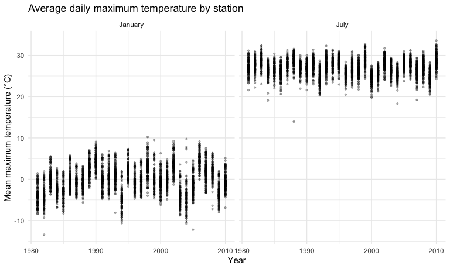
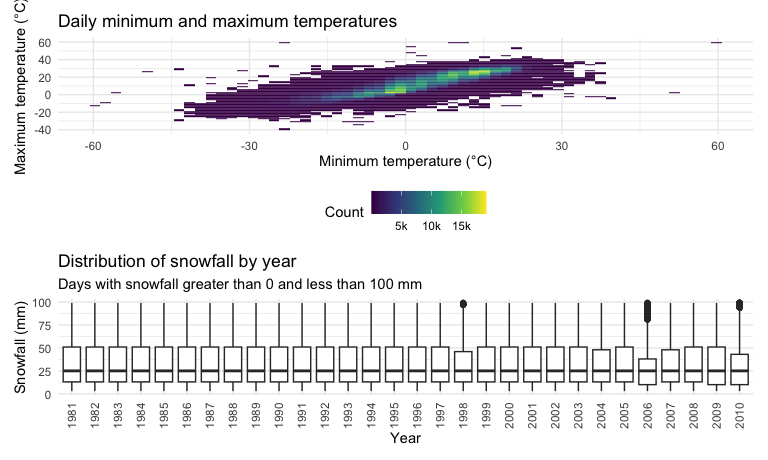

Homework 3
================
Stephanie Chuquipul Calderon
2026-10-18

## Problem 1

``` r
data("ny_noaa")

ny_noaa
```

    ## # A tibble: 2,595,176 × 7
    ##    id          date        prcp  snow  snwd tmax  tmin 
    ##    <chr>       <date>     <int> <int> <int> <chr> <chr>
    ##  1 US1NYAB0001 2007-11-01    NA    NA    NA <NA>  <NA> 
    ##  2 US1NYAB0001 2007-11-02    NA    NA    NA <NA>  <NA> 
    ##  3 US1NYAB0001 2007-11-03    NA    NA    NA <NA>  <NA> 
    ##  4 US1NYAB0001 2007-11-04    NA    NA    NA <NA>  <NA> 
    ##  5 US1NYAB0001 2007-11-05    NA    NA    NA <NA>  <NA> 
    ##  6 US1NYAB0001 2007-11-06    NA    NA    NA <NA>  <NA> 
    ##  7 US1NYAB0001 2007-11-07    NA    NA    NA <NA>  <NA> 
    ##  8 US1NYAB0001 2007-11-08    NA    NA    NA <NA>  <NA> 
    ##  9 US1NYAB0001 2007-11-09    NA    NA    NA <NA>  <NA> 
    ## 10 US1NYAB0001 2007-11-10    NA    NA    NA <NA>  <NA> 
    ## # ℹ 2,595,166 more rows

``` r
ny_noaa |>
  summarize(across(everything(), ~ mean(is.na(.x)))) |>
  pivot_longer(
    cols = everything(),
    names_to = "variable",
    values_to = "proportion_missing"
  ) |>
  knitr::kable(digits = 3)
```

| variable | proportion_missing |
|:---------|-------------------:|
| id       |              0.000 |
| date     |              0.000 |
| prcp     |              0.056 |
| snow     |              0.147 |
| snwd     |              0.228 |
| tmax     |              0.437 |
| tmin     |              0.437 |

``` r
ny_noaa |>
  summarize(
    n_stations = n_distinct(id),
    first_date = min(date),
    last_date = max(date)
  )
```

    ## # A tibble: 1 × 3
    ##   n_stations first_date last_date 
    ##        <int> <date>     <date>    
    ## 1        747 1981-01-01 2010-12-31

The ny_noaa dataset contains 2,595,176 observations and 7 variables,
representing daily weather records from 747 stations in New York State
between 1981 and 2010. Each row represents a station on a particular
date. Variables include station ID (id), date (date), precipitation
(prcp), snowfall (snow), snow depth (snwd), and maximum and minimum
temperatures (tmax and tmin). Missing data are substantial, particularly
for temperature: approximately 43.7% of both maximum and minimum
temperature values are missing. Precipitation, snowfall, and snow depth
are approximately 5.6%, 14.7%, and 22.8% missing, respectively. These
gaps limit the observations available for each analysis.

``` r
noaa_df =
  ny_noaa |>
  mutate(
    year = lubridate::year(date),
    month = lubridate::month(date),
    day = lubridate::day(date),
    tmax = as.numeric(tmax) / 10,
    tmin = as.numeric(tmin) / 10,
    prcp = prcp / 10
  )

noaa_df
```

    ## # A tibble: 2,595,176 × 10
    ##    id          date        prcp  snow  snwd  tmax  tmin  year month   day
    ##    <chr>       <date>     <dbl> <int> <int> <dbl> <dbl> <dbl> <dbl> <int>
    ##  1 US1NYAB0001 2007-11-01    NA    NA    NA    NA    NA  2007    11     1
    ##  2 US1NYAB0001 2007-11-02    NA    NA    NA    NA    NA  2007    11     2
    ##  3 US1NYAB0001 2007-11-03    NA    NA    NA    NA    NA  2007    11     3
    ##  4 US1NYAB0001 2007-11-04    NA    NA    NA    NA    NA  2007    11     4
    ##  5 US1NYAB0001 2007-11-05    NA    NA    NA    NA    NA  2007    11     5
    ##  6 US1NYAB0001 2007-11-06    NA    NA    NA    NA    NA  2007    11     6
    ##  7 US1NYAB0001 2007-11-07    NA    NA    NA    NA    NA  2007    11     7
    ##  8 US1NYAB0001 2007-11-08    NA    NA    NA    NA    NA  2007    11     8
    ##  9 US1NYAB0001 2007-11-09    NA    NA    NA    NA    NA  2007    11     9
    ## 10 US1NYAB0001 2007-11-10    NA    NA    NA    NA    NA  2007    11    10
    ## # ℹ 2,595,166 more rows

``` r
noaa_df |>
  filter(!is.na(snow)) |>
  count(snow, sort = TRUE) |>
  slice_head(n = 10) |>
  knitr::kable()
```

| snow |       n |
|-----:|--------:|
|    0 | 2008508 |
|   25 |   31022 |
|   13 |   23095 |
|   51 |   18274 |
|   76 |   10173 |
|    8 |    9962 |
|    5 |    9748 |
|   38 |    9197 |
|    3 |    8790 |
|  102 |    6552 |

I created separate year, month, and day variables, converted
temperatures to numeric values in degrees Celsius, and converted
precipitation to millimeters. Snowfall and snow depth were retained in
millimeters. The most common snowfall value is 0 mm, appearing in
2,008,508 observations, which is expected because most days have no
snowfall. The next most common values are 25, 13, and 51 mm. These are
approximately 1, 0.5, and 2 inches, suggesting that measurements
recorded in inches were converted to millimeters and rounded.

``` r
noaa_monthly_df =
  noaa_df |>
  filter(month %in% c(1, 7), !is.na(tmax)) |>
  group_by(id, year, month) |>
  summarize(
    mean_tmax = mean(tmax),
    .groups = "drop"
  ) |>
  mutate(
    month = factor(
      month,
      levels = c(1, 7),
      labels = c("January", "July")
    )
  )

noaa_monthly_df |>
  ggplot(aes(x = year, y = mean_tmax)) +
  geom_point(alpha = .3, size = .8) +
  facet_grid(. ~ month) +
  labs(
    title = "Average daily maximum temperature by station",
    x = "Year",
    y = "Mean maximum temperature (°C)"
  )
```



``` r
noaa_monthly_df |>
  filter(month == "July") |>
  arrange(mean_tmax) |>
  slice_head(n = 5)
```

    ## # A tibble: 5 × 4
    ##   id           year month mean_tmax
    ##   <chr>       <dbl> <fct>     <dbl>
    ## 1 USC00308962  1988 July       14.0
    ## 2 USC00302454  2004 July       18.3
    ## 3 USC00308946  1984 July       19.1
    ## 4 USC00309389  2007 July       19.2
    ## 5 USC00306957  2000 July       19.8

``` r
noaa_df |>
  filter(id == "USC00308962", year == 1988, month == 7) |>
  summarize(
    recorded_days = n(),
    days_with_tmax = sum(!is.na(tmax)),
    mean_tmax = mean(tmax, na.rm = TRUE),
    min_tmax = min(tmax, na.rm = TRUE),
    max_tmax = max(tmax, na.rm = TRUE)
  )
```

    ## # A tibble: 1 × 5
    ##   recorded_days days_with_tmax mean_tmax min_tmax max_tmax
    ##           <int>          <int>     <dbl>    <dbl>    <dbl>
    ## 1            31             31      14.0      8.3     20.6

July has much higher average maximum temperatures than January,
reflecting seasonal differences. Stations also vary within each year,
and January shows more pronounced year-to-year fluctuations than July.
An unusually low July average occurs at station USC00308962 in 1988, at
approximately 13.95°C. All 31 days have maximum temperature records, so
missing days do not explain this outlier. Further investigation would be
needed to determine whether it reflects actual conditions or a recording
issue.

``` r
temperature_plot =
  noaa_df |>
  drop_na(tmin, tmax) |>
  ggplot(aes(x = tmin, y = tmax)) +
  geom_bin2d(bins = 60) +
  scale_fill_viridis_c(
  breaks = c(5000, 10000, 15000),
  labels = c("5k", "10k", "15k")
) +
  labs(
    title = "Daily minimum and maximum temperatures",
    x = "Minimum temperature (°C)",
    y = "Maximum temperature (°C)",
    fill = "Count"
  )

snowfall_plot =
  noaa_df |>
  filter(snow > 0, snow < 100) |>
  ggplot(aes(x = factor(year), y = snow)) +
  geom_boxplot() +
  labs(
    title = "Distribution of snowfall by year",
    subtitle = "Days with snowfall greater than 0 and less than 100 mm",
    x = "Year",
    y = "Snowfall (mm)"
  ) +
  theme(axis.text.x = element_text(angle = 90, hjust = 1, vjust = .5))

temperature_plot / snowfall_plot
```



Minimum and maximum daily temperatures show a strong positive
association: days with higher minimum temperatures generally have higher
maximum temperatures. Some extreme values and observations where the
maximum is below the minimum suggest possible recording issues. Among
days with snowfall greater than 0 and less than 100 mm, distributions
are fairly similar across years, with medians near 25 mm and some
variation in spread. There is no obvious consistent trend over time
within this restricted range.
